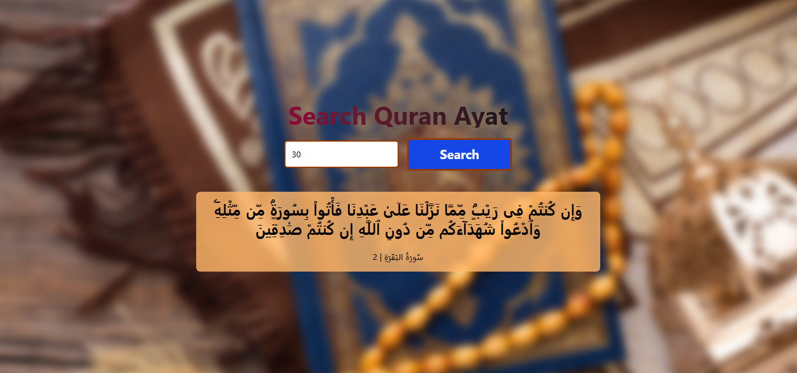

# 📖 Quran Ayat Finder App 💖

A sleek and interactive web application built with **React.js** and styled using **Tailwind CSS**. This app allows users to search for any specific Ayah (verse) of the Holy Quran by its global index number (from 1 to 6236) and instantly retrieves the Arabic text along with its corresponding Surah details using the public **Al-Quran Cloud API**.

---

## ✨ Features

- **Direct Ayat Search:** Enter any number between 1 and 6236 to look up a specific verse.
- **Dynamic API Integration:** Fetches real-time data asynchronously using the `fetch` API.
- **Robust Error Handling:** Validates user inputs and handles network or out-of-range errors gracefully.
- **Loading States:** Displays a smooth loading indicator while data is being fetched.
- **Immersive UI Design:** Features a blurred, full-screen background image paired with a modern, responsive layout.

---

## 🚀 Project Summary

The app utilizes a single-component React structure (`App.jsx`) where state management handles user inputs, fetched data, loading spinners, and error states. When a user types a number and triggers a search, the app validates the input, queries the `alquran.cloud` API endpoint (`/v1/ayah/{number}/ar.alafasy`), and renders the verse text along with its Surah name and number.

---

## 🧠 Core React.js Topics Used

This project implements several fundamental concepts of modern React:

1. **`useState` Hook:**
   - Used to manage component states such as the fetched `ayat` data, the current `ayatNum` entered by the user, `loading` status, and `error` messages.
   
2. **`useEffect` Hook:**
   - Synchronizes side effects—specifically fetching the Quranic verse whenever the `ayatNum` state updates, ensuring the UI stays reactive to user inputs.

3. **Asynchronous JavaScript (`async/await` & `try...catch...finally`):**
   - Handles network requests cleanly, managing HTTP response validation, error throwing, and resetting loading states reliably via the `finally` block.

4. **Conditional Rendering:**
   - Dynamically toggles between displaying the verse card, loading text, or error/fallback messages based on the current state (`loading`, `error`, and `ayat !== null`).

---

## 🎨 How & Where Tailwind CSS is Used

Tailwind CSS is utilized extensively throughout the application via utility classes to achieve a responsive, modern design without writing custom CSS stylesheets:

- **Layout & Positioning (`relative`, `absolute`, `flex`, `h-screen`, `overflow-hidden`):** 
  - Used on the main section wrapper to create a full-screen, clipping container that centers all inner content perfectly.
- **Background Styling (`object-cover`, `blur-sm`, `scale-105`):** 
  - Applied to the background image (``) to give it a modern frosted/blurred aesthetic with a slight scale zoom.
- **Typography & Gradients (`text-5xl`, `font-bold`, `bg-gradient-to-r`, `bg-clip-text`, `text-transparent`):** 
  - Creates an eye-catching gradient color effect on the main app heading ("Search Quran Ayat").
- **Interactive Elements & Transitions (`transition-colors`, `duration-200`, `hover:bg-blue-700`):** 
  - Styled the search button with custom borders, padding, and smooth color-shifting hover effects.
- **Cards & Opacity (`bg-orange-300/80`, `rounded-lg`, `p-4`, `max-w-3xl`):** 
  - Formats the fetched Ayat display box with a semi-transparent background, rounded corners, and constrained maximum width for readability.

---

### Image Here 📸


## 📦 Getting Started & Installation

To run this project locally on your machine, follow these steps:

1. **Clone the repository:**
   ```bash
   git clone [https://github.com/your-username/quran-ayat-app.git](https://github.com/your-username/quran-ayat-app.git)


## 🚀 Live Demo

This app is **successfully deployed on Vercel**! 🎉

👉 **[Click here to visit the app](https://quran-verses-app-virid.vercel.app)** 🌐

Please check it out and share your feedback! 💬

## 🌟 Features

- 🔍 Search any Ayat by its number
- 🕌 Beautiful Arabic text with Surah name
- 🎨 Clean interface with a blurred background image
- ⚡ Fast and responsive design

## 🛠️ Built With

- ⚛️ React
- 🎨 Tailwind CSS
- ▲ Vercel (deployment)

## 🤲 Dua

*May this app be a source of benefit for everyone. Aameen Summa Aameen.*

---

Made with ❤️ by **Mariam**
